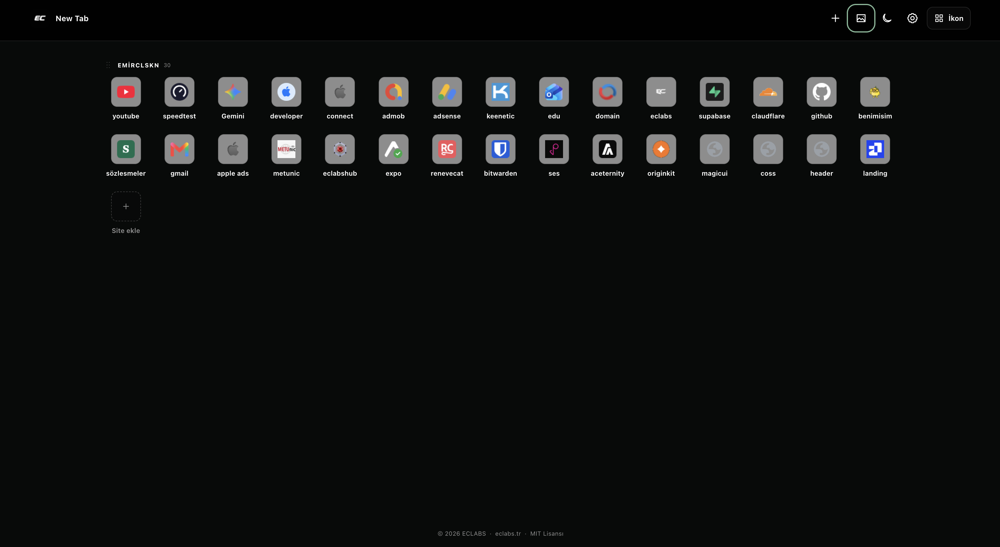
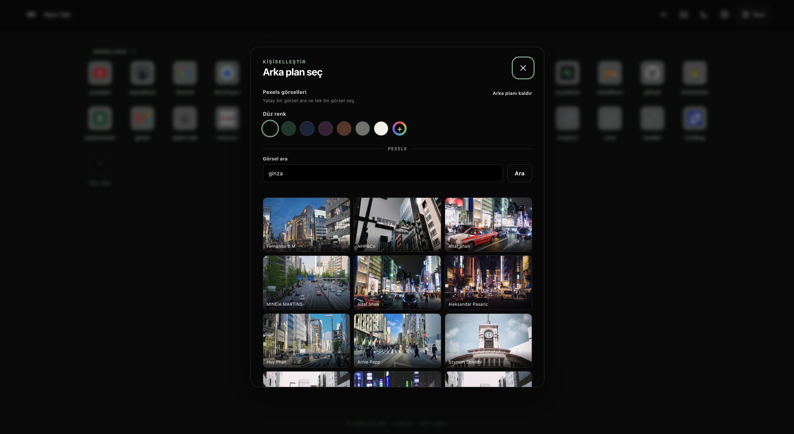

# ECLABS Launch

[](LICENSE)
[](manifest.json)
[](app.js)

ECLABS Launch, Brave ve Chrome için hızlı, minimal ve açık kaynak bir Manifest V3 yeni sekme uzantısıdır. Siteleri sayfalara bölmeden kategoriler altında listeler; tüm kullanıcı verileri cihazda kalır.

> **ECLABS tarafından geliştirildi.** Diğer ECLABS ürünlerini ve çalışmalarını keşfetmek için [eclabs.tr](https://eclabs.tr) adresini ziyaret edin.

## Özellikler

- Yoğun, çok sütunlu **Liste** görünümü ve favicon kullanan responsive **İkon** görünümü
- Sınırsız dikey akış; kategori ve sitelerde ekleme, düzenleme, silme ve sürükle-bırak sıralama
- Görünüm, tema, arama çubuğu ve ikon kartı boyutu ayarları
- JSON içe/dışa aktarma; Brave New Tab HTML ve isteğe bağlı yer imi/sık kullanılan site aktarımı
- Göz yormayan açık tema, siyah koyu tema ve çevrimdışı renk/gradient fallback
- Kullanıcı isteğiyle çalışan Pexels araması, tek görsel seçimi ve fotoğrafçı atfı
- Cloudflare Worker üzerinde arama hız sınırı ve kontrollü istemci doğrulaması
- Hesap, analytics, reklam, remote JavaScript veya harici uygulama backend'i yok

## Ekran görüntüleri

### İkon görünümü



### Arka plan seçici



## Yerel kurulum

Bu proje build sistemi gerektirmez. Repoyu klonlayın:

```bash
git clone https://github.com/emirclskn-dev/eclabs-launch.git
cd eclabs-launch
```

### Brave

1. `brave://extensions` adresini açın.
2. **Geliştirici modu** seçeneğini etkinleştirin.
3. **Paketlenmemiş öğe yükle** seçeneğine basıp repo kökünü seçin.
4. Uzantı kartındaki kimliği kopyalayın; Worker allowlist'i için gereklidir.

### Chrome

1. `chrome://extensions` adresini açın.
2. **Geliştirici modu** seçeneğini etkinleştirin.
3. **Paketlenmemiş öğe yükle** seçeneğine basıp repo kökünü seçin.
4. Uzantı kartındaki kimliği kopyalayın.

## Cloudflare Worker kurulumu

Worker, Pexels API anahtarının uzantıya veya public repoya girmesini engeller. Kurulum yapılacak Cloudflare hesabını siz seçersiniz; bu repo hesap kimliği veya secret içermez.

1. [Pexels API](https://www.pexels.com/api/) erişiminizi hazırlayın.
2. Worker yapılandırmasını kopyalayın:

```bash
cd worker
cp wrangler.toml.example wrangler.toml
```

3. `wrangler.toml` içindeki iki `REPLACE_WITH_EXTENSION_ID` değerini Brave/Chrome uzantı kimliğiyle değiştirin. Birden fazla izinli origin virgülle ayrılabilir; `EXTENSION_ID` kullanılan tarayıcıdaki kimlikle aynı olmalıdır. Aynı Cloudflare hesabında `1001` kullanılıyorsa rate-limit `namespace_id` değerini başka bir pozitif tamsayıyla değiştirin.
4. Seçtiğiniz Cloudflare hesabında oturum açın ve secret'ı etkileşimli olarak tanımlayın:

```bash
npx wrangler@latest login
npx wrangler@latest secret put PEXELS_API_KEY
```

5. Worker'ı yayımlayın:

```bash
npx wrangler@latest deploy
```

6. Self-host kullanıyorsanız dönen `https://...workers.dev` adresini `app.js` içindeki `PEXELS_PROXY_URL` sabitine yazın. Son kullanıcı arayüzünde Worker adresi değiştirilemez. Uzantı ağ iznini yalnızca `workers.dev` ve yerel geliştirme adresleri için isteyebilir.

Yerel Worker geliştirmesinde, git tarafından yok sayılan `worker/.dev.vars` dosyasına yalnızca aşağıdaki değişkeni ekleyin ve ardından geliştirme sunucusunu başlatın:

```text
PEXELS_API_KEY=yerel_gelistirme_anahtari
```

```bash
npx wrangler@latest dev
```

Gerçek anahtarı hiçbir zaman `wrangler.toml`, manifest, JavaScript, issue veya commite eklemeyin. Production secret değerini görmek veya repoya yazmak gerekmez.

## Geliştirme yapısı

```text
.
├── manifest.json
├── newtab.html
├── style.css
├── app.js
├── icons/
└── worker/
    ├── src/index.js
    └── wrangler.toml.example
```

Uzantı yalnızca `storage` ve favicon erişimini zorunlu ister. `topSites`, `bookmarks` ve yapılandırılan Worker host izni, ilgili özellik ilk kez kullanıcı tarafından çalıştırıldığında isteğe bağlı olarak talep edilir.

## Katkı

Katkı akışı ve kalite beklentileri için [CONTRIBUTING.md](CONTRIBUTING.md) dosyasını okuyun. Güvenlik sorunlarını public issue yerine [SECURITY.md](SECURITY.md) içindeki özel bildirim yoluyla iletin.

## Gizlilik

Site verileri yalnızca `chrome.storage.local` içinde tutulur. Pexels araması kendiliğinden çalışmaz; yalnızca ayarlarda kullanıcı arama yaptığında Worker'a gider. Seçilen fotoğraf dosyası IndexedDB, Cache Storage veya `chrome.storage` içine kopyalanmaz. Ayrıntılar: [PRIVACY.md](PRIVACY.md).

## Lisans

Bu proje [MIT Lisansı](LICENSE) altında yayımlanır. Pexels görselleri, fotoğrafçı ve Pexels bağlantısı ile birlikte gösterilir; görseller Pexels'in kendi kullanım koşullarına tabidir.

---

[ECLABS](https://eclabs.tr) tarafından geliştirildi.
